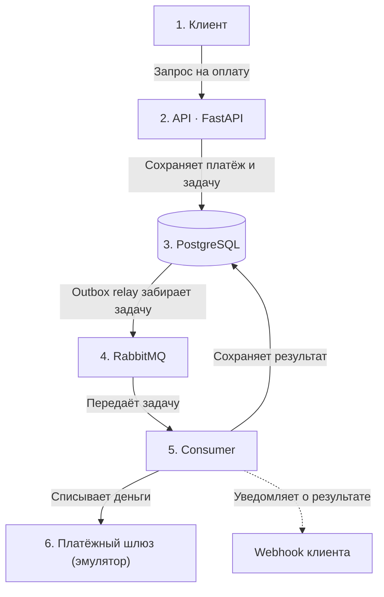
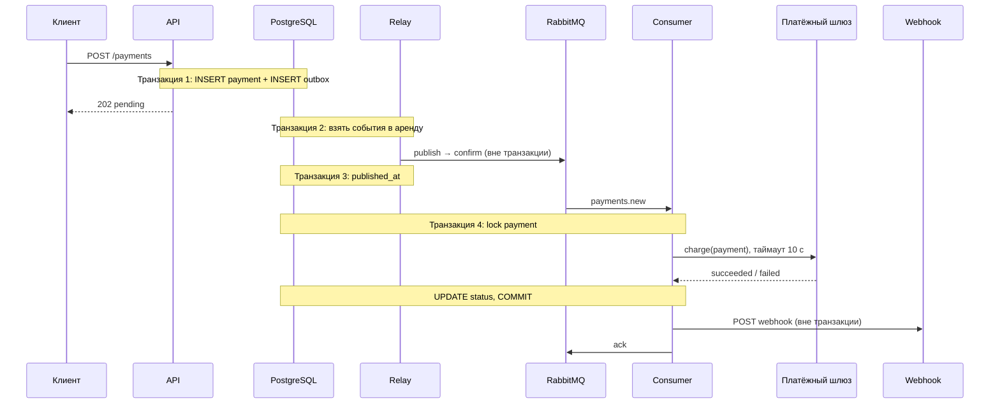

# Архитектура

## Как устроен сервис

- **PostgreSQL хранит состояние платежей.** Сообщение в RabbitMQ содержит только идентификаторы (`event_id`, `payment_id`) и время события, а данные и актуальный статус платежа consumer читает из БД.
- **RabbitMQ доставляет события** между API и consumer.
- **Outbox связывает БД и брокер:** платёж и событие сохраняются одной транзакцией, а событие публикуется после её завершения.
- **Повторная доставка ожидаема.** События доставляются по принципу at-least-once, поэтому сообщения могут дублироваться. Consumer не списывает деньги повторно; получатель webhook-а должен отсекать дубли уведомлений.

Два процесса (`api` и `consumer`) используют один пакет и Docker-образ, одну БД и один брокер.

## Как это работает — коротко

Клиент отправляет запрос на оплату. API сохраняет платёж и задачу на его обработку в PostgreSQL, после чего сразу отвечает `202 Accepted`. Фоновый процесс передаёт задачу в RabbitMQ, а consumer списывает деньги через платёжный шлюз (по ТЗ — его эмулятор), сохраняет результат в базе и отправляет клиенту webhook.



## Что делает каждый компонент

- **API (FastAPI)** принимает запрос и проверяет `Idempotency-Key`. Оно не ждёт завершения оплаты.
- **PostgreSQL** хранит платежи и таблицу `outbox` с задачами, которые ещё нужно отправить в очередь.
- **Outbox relay** периодически читает `outbox` и публикует задачи в RabbitMQ. Если сервис перезапустится, неотправленные задачи останутся в базе.
- **RabbitMQ** передаёт задачи consumer-у. Если обработка временно не удалась, сообщение можно повторить позже.
- **Consumer** вызывает платёжный шлюз, сохраняет итоговый статус платежа и отправляет webhook.
- **Платёжный шлюз (эмулятор)** — по ТЗ сервис обрабатывает платежи «через внешний платёжный шлюз (эмуляцию)». В реальности это внешний сервис вроде ЮKassa или Stripe, который списывает деньги с карты. Эмулятор (`consumer/gateway.py`) отвечает за 2–5 секунд и одобряет около 90% платежей; повторный вызов для того же платежа даёт тот же ответ, как настоящий шлюз с ключом идемпотентности. Шлюз описан протоколом `PaymentGateway` с методом `charge()`: настоящий подключается новым классом без изменений в consumer.
- **Webhook** — HTTP-уведомление внешней системы о результате платежа.

**Модели разделены по слоям:** Pydantic описывает HTTP-схемы и контракт сообщений, dataclasses — доменные объекты, SQLAlchemy Core — таблицы (`Table`) и запросы.

**SQLAlchemy используется без ORM.** Запросы пишутся явно (`select`, `update`, `insert … on conflict`), результат приходит обычными строками и сразу превращается в доменные объекты. Транзакция — `async with engine.begin() as conn:`. ORM-сессия с её identity map и неявными запросами здесь ничего бы не дала: запросы и так явные, а связей между таблицами нет. Суммы хранятся как `Decimal` / `NUMERIC(18,2)` и передаются в JSON строкой.

## Данные

- **`payments`** хранит данные платежа, статус (`pending` → `succeeded` или `failed`), `idempotency_key` с ограничением UNIQUE и `request_fingerprint` — SHA-256 тела запроса. Основные инварианты дополнительно защищены `CHECK`-ограничениями.
- **`outbox`** хранит `id` (он же `message_id` в RabbitMQ), `routing_key`, `payload`, время публикации `published_at`, число попыток `attempts`, последнюю ошибку `last_error`, срок аренды `locked_until` и время следующей попытки `next_attempt_at`. Для неопубликованных записей есть частичный индекс.

Ошибка доставки webhook-а не меняет результат платежа: списание и уведомление — разные вещи.

## Жизненный цикл и транзакции



| Транзакция | Что в ней происходит | Почему остальное снаружи |
|---|---|---|
| 1. API | Платёж и запись outbox | Публикацию нельзя атомарно объединить с коммитом БД |
| 2. Relay | Выбор пачки событий и аренда | Сетевой вызов не должен держать транзакцию |
| 3. Relay | Сохранение результата публикации | Короткая транзакция после ответа брокера |
| 4. Consumer | Блокировка платежа, вызов шлюза с таймаутом, смена статуса | Webhook отправляется вне транзакции, чтобы не держать блокировку во время HTTP-запроса |

Транзакции открывает сервисный слой, а не репозитории.

## Outbox

Outbox закрывает два окна сбоя: событие не потеряется между сохранением платежа и публикацией, а consumer не получит событие о платеже, которого ещё нет в БД.

Relay работает в три шага:

1. **Забирает события в аренду.** Один `UPDATE` выставляет `locked_until = now() + 30 с` и коммитится. `FOR UPDATE SKIP LOCKED` не позволяет двум relay одновременно забрать одну строку.
2. **Публикует без открытой транзакции.** События одной пачки отправляются параллельно с publisher confirms и `mandatory`. Если сообщение не удалось маршрутизировать, публикация считается неуспешной.
3. **Сохраняет результат.** Для успешной публикации выставляется `published_at`; при ошибке обновляются `attempts`, `last_error` и `next_attempt_at` с растущей задержкой (1, 2, 4 секунды и далее). Ошибка одного события не мешает обработать остальные.

После падения relay аренда истечёт через 30 секунд. Доставка — **at-least-once**: сбой после подтверждения брокера, но до записи результата в БД приведёт к повторной публикации. Идемпотентность защищает от повторного списания.

Readiness API проверяет PostgreSQL. При недоступности RabbitMQ платежи принимаются, а события ждут в `outbox`.

## RabbitMQ и повторы

```text
relay ─► [payments] ─► (payments.new) ─► consumer: шлюз → статус в БД → webhook, затем:
  успех       ─► ack
  повторяемая ─► [payments.retry] ─► (payments.new.retry.<N>ms) ─TTL─► [payments]
  финальная   ─► reject ─► [payments.dlx] ─► (payments.new.dlq)
```

- Используются **quorum queues**.
- Для пауз в 2 и 4 секунды используются отдельные TTL-очереди. `sleep` занимал бы слот consumer, а общая очередь с разным TTL могла бы задерживать короткие повторы за длинными.
- Сообщения в DLQ попадают через `x-dead-letter-exchange`.
- Relay и consumer объявляют одну и ту же топологию идемпотентно, поэтому порядок их запуска не важен.

Consumer подтверждает сообщение вручную и только после сохранения результата:

| Ситуация | Действие |
|---|---|
| Обработка завершилась успешно | `ack` |
| Ошибка повторяемая, попытки остались | Опубликовать копию в delay-очередь с `x-attempt+1`, дождаться подтверждения брокера (таймаут 5 секунд), затем `ack` оригинала |
| Не удалось опубликовать копию | Не подтверждать оригинал; после такой же задержки вернуть его через `nack` |
| Попытки закончились или ошибка неповторяемая | `reject` → DLQ |
| Сообщение некорректно | Сразу в DLQ |

К повторяемым относятся сетевые ошибки, таймауты, ответы `5xx`, `408`, `425` и `429`, а также неизвестные исключения (например, недоступность БД). Ответ `4xx` от webhook-получателя, отсутствующий платёж и некорректное сообщение не повторяются. Отказ шлюза с вероятностью 10% — штатный результат `failed`, а не техническая ошибка.

Всего предусмотрено три попытки: первая доставка и два повтора через 2 и 4 секунды. Номер попытки рассчитывается по `x-attempt` и `x-delivery-count` (счётчику RabbitMQ), поэтому возврат через `nack` тоже учитывается. Служебные заголовки брокера в retry-копию не переносятся.

`x-delivery-limit: 10` — дополнительная защита: если consumer падает до выбора действия, RabbitMQ отправит сообщение в DLQ после десяти доставок.

## Идемпотентность

**На стороне API.** Платёж создаётся через один `INSERT … ON CONFLICT (idempotency_key) DO NOTHING`. Это защищает от двух одновременных запросов с одним ключом. Вместе с ключом хранится отпечаток тела: тот же ключ с другим запросом приводит к `409`.

**На стороне consumer.**

- Строка платежа блокируется через `FOR UPDATE SKIP LOCKED`. Если её уже обрабатывает другая реплика, текущая подтверждает дубль и пропускает его: сообщение первой реплики ещё не подтверждено и вернётся в очередь, если она упадёт.
- Статус меняется только у платежа со статусом `pending` (`UPDATE … WHERE status = 'pending'`).
- Для платежа с финальным статусом шлюз повторно не вызывается. Если не удался только webhook, при повторе отправляется уведомление, а не повторяется списание.
- Эмулятор шлюза идемпотентен по `payment.id`: результат детерминирован по ID, поэтому повторная обработка после сбоя возвращает тот же результат.

**Webhook-и.** Доставка тоже работает по принципу at-least-once. `X-Webhook-Id` равен `payment_id` и не меняется между повторами; тело подписывается HMAC через `X-Webhook-Signature`.

Защита от дублей покрывает списание, но не уведомления: статус доставки webhook-а в БД не хранится, поэтому повтор сообщения может отправить webhook ещё раз. Даже отдельный статус не убрал бы все дубли — процесс может упасть после успешного ответа, но до записи результата. Получателю всё равно нужна дедупликация по `X-Webhook-Id`.

## Что происходит при сбоях

| Сбой | Поведение | Проверено |
|---|---|---|
| RabbitMQ недоступен | API отвечает `202`; события ждут в `outbox` и отправляются после восстановления | e2e |
| API упал после коммита, но до ответа | Клиент повторяет запрос с тем же ключом и получает тот же платёж | тест |
| Relay упал после аренды событий | После истечения аренды события может забрать другой relay | — |
| Relay упал после confirm, но до записи результата | Событие публикуется повторно, повторного списания нет | тест повторной доставки |
| Шлюз завис | Через 10 секунд запрос завершается по таймауту, транзакция откатывается, платёж остаётся `pending`, сообщение повторяется. Дополнительная защита — `idle_in_transaction_session_timeout` в PostgreSQL (30 секунд) | тест |
| Consumer получил `kill -9` во время вызова шлюза | Транзакция откатывается, сообщение возвращается в очередь, платёж обрабатывается один раз | e2e |
| Две реплики получили одно сообщение | Шлюз вызывается один раз | тест |
| Пришёл дубль для уже проведённого платежа | Шлюз не вызывается; webhook может отправиться повторно, получатель отсекает дубль по `X-Webhook-Id` | тест, e2e |
| Webhook временно недоступен | Выполняются повторы, повторного списания нет | e2e, тест |
| Webhook долго недоступен или отвечает `4xx` | Сообщение уходит в DLQ, статус платежа не меняется | e2e, тест |
| Не удалось опубликовать retry-копию | Оригинал не теряется: его возвращают в очередь после задержки; после исчерпания попыток — DLQ | e2e, тест |
| PostgreSQL недоступна | API возвращает `500`, readiness — `503`; после восстановления повтор с тем же ключом создаёт ровно один платёж. Consumer повторяет обработку, а при долгом сбое сообщение может попасть в DLQ | e2e (API) |
| Получен SIGTERM | Consumer завершает текущую обработку (до 30 секунд); неподтверждённые сообщения вернутся в очередь. API ждёт остановки relay до 10 секунд и при любом исходе закрывает соединения с БД; неопубликованные события остаются в `outbox` | e2e (API) |

## Эксплуатация

- **Health-check-и:** `/health/live` и `/health/ready`. Readiness проверяет только PostgreSQL, чтобы сбой RabbitMQ сам по себе не исключал API из балансировки.
- **Логи:** одна строка на событие в stdout: `время (UTC) уровень источник: сообщение ключ=значение…`. Во всех строках о платеже есть `payment_id`, поэтому его историю от POST до ack находит один `grep`.
- **Миграции:** `api` применяет их при старте (`alembic upgrade head`), consumer ждёт готовности `api`. Alembic не блокирует параллельный запуск, поэтому при нескольких репликах API в production миграции лучше выносить в отдельный шаг деплоя.
- **Параллелизм consumer:** задаётся `PREFETCH_COUNT = 10` в `consumer/app.py`. Во время вызова шлюза каждое сообщение удерживает соединение с БД, поэтому пул должен быть не меньше prefetch. Масштабирование: `--scale consumer=N`.
- **Что мониторить:** возраст самой старой неопубликованной записи outbox, размер DLQ и платежи, которые слишком долго остаются `pending`.
- **DLQ:** сообщения просматриваются через RabbitMQ Management UI. После устранения причины их можно вернуть в `payments.new`; обработка платежей идемпотентна.
- **Настройки очередей:** аргументы вроде `x-delivery-limit` и TTL нельзя изменить у уже созданной очереди — RabbitMQ вернёт `PRECONDITION_FAILED`. Локально очередь можно пересоздать; в production такие параметры лучше задавать через RabbitMQ policy.

## Известные компромиссы

- **Транзакция открыта во время вызова шлюза.** Соединение с БД и блокировка удерживаются до таймаута (10 секунд). Для реальной нагрузки лучше добавить статус `processing` с арендой и вызывать шлюз вне транзакции. Это потребует аккуратно обрабатывать повторное сообщение для платежа, который уже находится в активной обработке.
- **Webhook использует то же сообщение, что и обработка платежа.** Чище было бы публиковать отдельное событие `payment.processed` через outbox и доставлять webhook в отдельной очереди с собственной retry-политикой.
- **На инфраструктурные ошибки мало попыток.** При недоступной БД сообщение может быстро попасть в DLQ. Для таких сбоев лучше увеличить лимит или временно приостанавливать получение сообщений.
- **Outbox проверяется опросом каждые 0,5 секунды.** Позже можно добавить `LISTEN/NOTIFY` и очистку уже опубликованных записей.
- **До production не хватает:** защиты от SSRF через `webhook_url`, отдельных API-ключей для клиентов, метрик и трассировки.
